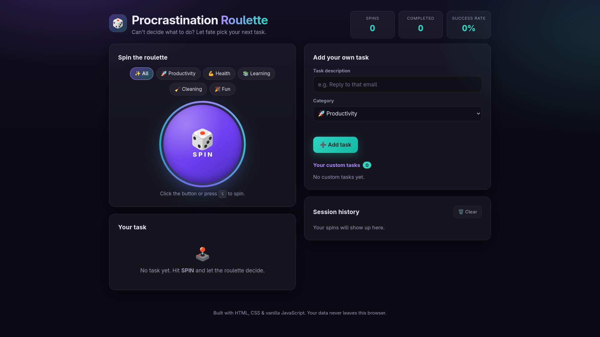

# 🎰 Procrastination Roulette

A fun, interactive web app that helps you beat procrastination by turning your next task into a game. Spin the roulette, get a random task, and start taking action!

\<p align="center">
&#x20; \<a href="[https://pro-roulette.netlify.app/](https://pro-roulette.netlify.app/)">\<strong>🚀 Live Demo\</strong>\</a>
&#x20; ·
&#x20; \<a href="[https://github.com/dvrone/procrastination-roulette](https://github.com/dvrone/procrastination-roulette)">\<strong>💻 Source Code\</strong>\</a>
\</p>

## ✨ Features

- 🎰 **Random Task Selection** — Spin the roulette to discover your next task.
- 🎯 **Task Categories** — Organize activities by category.
- ➕ **Custom Tasks** — Add your own tasks to the roulette.
- ✅ **Task Completion** — Mark tasks as completed and track your progress.
- 📜 **Task History** — Review previously selected tasks.
- 🎨 **Modern UI** — Enjoy a clean, game-inspired interface.
- 📱 **Responsive Design** — Use the application on desktop and mobile devices.

## 🛠️ Built With

- **HTML5** — Application structure
- **CSS3** — Styling, layout, and animations
- **JavaScript** — Roulette logic and interactive functionality
- **Netlify** — Deployment and hosting

## 📸 Screenshots

Explore the application's interface:

\<!-- Add your screenshots to the demo/ directory and update the paths below. -->



## 🚀 Getting Started

### Run Locally

1. Clone the repository:

   ```bash
   git clone https://github.com/dvrone/procrastination-roulette.git
   ```

2. Navigate to the project directory:

   ```bash
   cd procrastination-roulette
   ```

3. Open `index.html` in your browser.

No build process or package installation is required.

## 📂 Project Structure

```text
procrastination-roulette/
├── demo/
├── index.html
├── LICENSE
├── README.md
└── static/
    ├── css/
    │   └── styles.css
    └── js/
        └── main.js
```

## 🎮 How It Works

1. Open Procrastination Roulette.
2. Spin the roulette.
3. Get a randomly selected task.
4. Complete your mission.
5. Spin again and keep making progress!

The idea is simple: spend less time deciding what to do and more time actually doing it.

## 🎯 Project Goal

Procrastination Roulette was created as a small personal coding project exploring interactive web development, JavaScript logic, and playful approaches to productivity.

It combines a simple game mechanic with a practical goal: making it easier to take the first step when you're putting things off.

<!-- ## 🔮 Future Improvements

- [ ] Add more task categories and customizable difficulty levels.
- [ ] Improve roulette animations and sound effects.
- [ ] Add daily statistics and streak tracking.
- [ ] Enhance accessibility and keyboard navigation. -->

## 📄 License

This project is licensed under the terms of the [LICENSE](LICENSE) file.

---

\<p align="center">
&#x20; Made with ☕ and JavaScript by \<a href="[https://github.com/dvrone](https://github.com/dvrone)">dvrone\</a>
\</p>
